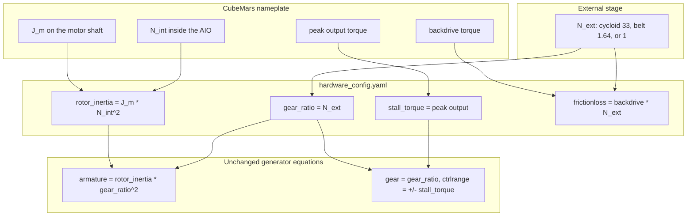

# Joint and actuator model

Each hardware joint is one rigid hinge and one ideal general actuator. MuJoCo integrates

```
(I_link(q) + I_a) q̈ + b q̇ + τ_dry = N * τ_cmd + τ_external
```

- `I_link(q)`: link inertia about the hinge, in kg·m², from the body inertials. It depends on the hinge angle `q` (rad).
- `I_a`: `armature`, in kg·m². Constant.
- `b`: `damping`, in N·m/(rad/s).
- `τ_dry`: Coulomb torque, in N·m, with `|τ_dry| ≤ frictionloss`. MuJoCo applies that bound as a constraint, so the joint can stick at zero speed.
- `N`: `gear`. Dimensionless. It is only the external stage.
- `τ_cmd`: `ctrl`, in N·m. CubeMars actuator-output torque, the same number as MIT `t_ff`.
- `τ_external`: contact, springs, and constraint torques on the hinge, in N·m.

The waist is the same hinge with a spring and no actuator.

## Inside and outside the MJCF

Inside the MJCF, on every hip, knee, and axle:

- `armature` (kg·m²), `damping` (N·m/(rad/s)), and `frictionloss` (N·m) on the hinge.
- `gear` and `ctrlrange` on the general actuator. `ctrlrange` is `±stall_torque`, in N·m.
- Gain stays 1, bias stays 0, and `dyntype` stays none, so commanded torque is applied in the same timestep. There is no backlash and no torsional windup.

The waist hinge has `stiffness` (N·m/rad) and `range`, plus its own `damping` and `frictionloss`, and no motor. The YAML `range` is ±25 deg. MjSpec takes range in degrees. The exported XML sets `angle="radian"` and stores ±0.436 rad. Hips, knees, and axles have no range.

One `joints` entry and one `motors` entry cover all four hips, all four knees, or all eight axles.

Left outside the MJCF:

- Servo `Kp` and `Kd`. The same position loop runs in simulation and on the robot. Folding `Kd` into the actuator makes it the same term as `damping`.
- The torque-speed ceiling `|τ| ≤ τ_peak (1 - |ω|/ω_nl)`, with torque in N·m and speed in rad/s. That is a clip in the interface that turns current into `ctrl`.
- Thermal continuous torque. `ctrlrange` is an instantaneous peak.
- A series spring, and the two-inertia joint that comes with it, only if the locked-output windup test shows deflection that matters at the frequencies of interest.
- Per-joint YAML overrides, only if unit-to-unit spread exceeds the fit residual.
- A `dyntype` filter, only if the current loop is slow relative to the simulation timestep. A kHz loop at a 1 ms step stays instantaneous.

## Torque frame

`ctrl` and `stall_torque` are CubeMars AIO output torque, in N·m, the same number as MIT `t_ff`, not motor-shaft torque. `gear_ratio` is only the external stage, `N_ext`.

`HardwareModel._add_actuated_link` still computes

```
armature = rotor_inertia * gear_ratio²
gear = gear_ratio
ctrlrange = ±stall_torque
```

`rotor_inertia` in the YAML is therefore `J_m * N_int²` at the AIO output shaft. `J_m` is the datasheet rotor inertia on the motor shaft. The conversion is 1 g·cm² = 1e-7 kg·m². Planet and cycloid inertia are omitted, so hip and knee `armature` are lower bounds. The joint torque limit is `stall_torque * gear_ratio`, in N·m.

Two ways to break that split: writing the bare motor-shaft `J_m` into `rotor_inertia` while `gear` is only `N_ext` drops hip `armature` by `N_int²` (10²). Writing the total ratio into `gear` while commanding CAN output torque multiplies hip torque by that same internal 10.



## Parameters

The table is the datasheet frame now in `hardware_config.yaml`, and what the generator compiles from it. `damping` is still an unidentified placeholder. `frictionloss` is still a datasheet backdrive prior, not a measured sliding friction. Total kinematic ratio `N_int * N_ext` is 330 on the hip, 104.96 on the knee, and 9 on the axle.

Datasheet `J_m` is 753.5, 564.5, and 1002 g·cm². Conversion: 1 g·cm² = 1e-7 kg·m².

| Joint | Module | Datasheet | J_m (kg·m²) | N_int | N_ext | rotor_inertia (kg·m²) | Armature (kg·m²) | stall_torque (N·m) | Joint limit (N·m) | frictionloss prior (N·m) | Damping (N·m/(rad/s)) |
| --- | --- | --- | --- | --- | --- | --- | --- | --- | --- | --- | --- |
| Hip, all four | AK70-10 KV100 | [AK70-10 KV100](https://www.cubemars.com/product/ak70-10-kv100-robotic-actuator.html) | 7.535e-5 | 10 | 33 cycloid | 0.007535 | 8.205615 | 24.8 | 818.4 | 15.84 | 2, placeholder |
| Knee, all four | AK80-64 KV80 | [AK80-64 KV80](https://www.cubemars.com/product/ak80-64-kv80-robotic-actuator.html) | 5.645e-5 | 64 | 1.64 belt | 0.2312192 | 0.621887 | 120 | 196.8 | 7.71 | 2, placeholder |
| Axle, all eight | AK10-9 V2.0 KV60 | [AK10-9 V2.0 KV60](https://www.cubemars.com/product/ak10-9-v2-0-kv60-robotic-actuator.html) | 1.002e-4 | 9 | 1, direct to the wheel | 0.0081162 | 0.0081162 | 48 | 48 | 0.8 | 2, placeholder |

`frictionloss` is AIO-output backdrive times `N_ext`: hip `0.48 * 33 = 15.84` N·m, knee `4.7 * 1.64 = 7.708` N·m stored as 7.71, axle `0.8 * 1 = 0.8` N·m. The XML writer prints hip `armature` as 8.20561. Axle actuators omit `gear="1"` because 1 is the MuJoCo default. The compiled actuator gear is 1.

`Kt` below is on the motor shaft, in N·m/A. `Kt * I_peak` is a few N·m. The advertised peak is the output torque, which is `stall_torque`.

| Joint | Kt (N·m/A) | No-load at 48 V | Backdrive at the AIO output (N·m) |
| --- | --- | --- | --- |
| Hip | 0.123 | 480 rpm, about 1.5 rad/s at the joint | 0.48 |
| Knee | 0.136 | 75 rpm, about 4.8 rad/s at the joint | 4.7 |
| Axle | 0.198 | 320 rpm, about 33 rad/s at the wheel | 0.8 |

AK10-9 V3.0 lists 53 N·m peak. This model uses V2.0's 48 N·m. The AK series manual packs AK10-9 MIT torque as ±54 N·m. Read firmware `T_MAX` on the hardware before treating 48 N·m as the CAN scale.

The previous YAML used `rotor_inertia` 0.0002 kg·m² and `stall_torque` 1.8 N·m for every actuator, with gears 160, 120, and 30. That produced hip, knee, and axle `armature` of 5.12, 2.88, and 0.18 kg·m², and joint torque limits of 288, 216, and 54 N·m. The hip torque limit was low (288 N·m against 818 N·m) and would have been 10× too strong if CAN output torque were multiplied by the old total-style gear. Knee `armature` was about 5× high. Axle `armature` was about 20× high, and it is now the same order as the wheel spin inertia.

Thigh inertia is about 0.01 kg·m² and shin inertia about 0.005 kg·m², so reflected inertia still dominates the hip and the knee. Wheel spin inertia is the same order as the new axle `armature`, so the wheel has to come off for the inertia test.

`damping` is 2 N·m/(rad/s) on every actuated joint. At the wheel no-load speed near 33 rad/s that viscous torque is about 66 N·m, larger than the 48 N·m peak, so the placeholder makes the wheels too slow until it is identified. Hip no-load is about 1.5 rad/s, where `b ω` is only a few N·m against an 818 N·m peak.

## frictionloss

MuJoCo applies one symmetric Coulomb torque as a constraint, so the joint can stick at zero speed. The stored values are datasheet backdrive priors in the joint frame, in N·m, not a measured sliding friction. Breakaway is higher than sliding. The simulated joint creeps under bias torques the real joint holds. A MuJoCo joint has no load-dependent gearbox friction and no direction-dependent efficiency. A constant `frictionloss` plus a constant `gear` cannot match both a no-load backdrive and a near-stall forward drive. Fit the regime you simulate.

The hip cycloid and the AK80-64 are poor backdrives: 0.48 N·m at the AK70-10 output, then 33:1, and 4.7 N·m on the AK80-64 before the belt. A passive pendulum is not a usable inertia test on those joints. The wheel, at 0.8 N·m, can be backdriven.

## What to measure next

The datasheet frame is already in the YAML. These steps replace it with measured joint inertia, `damping`, `frictionloss`, ranges, and the waist spring. Run the actuated-joint tests at operating grease temperature, after a defined warm-up. Repeat on at least two units of each type before copying one number to all four hips, four knees, or eight axles.

1. **Nameplate and sign.** Confirm KV, voltage, and firmware MIT `T_MAX`, so `ctrl` matches the CAN torque scale. Confirm the external ratios: cycloid nameplate 33, belt tooth counts for 1.64, and 1 on the wheel. One revolution of the joint moves the AIO output by `N_ext` turns. Set the encoder offset so `q = 0` matches the CAD pose. Positive `ctrl` has to flex the left and right knees the same way relative to the body. A y-axis hinge does not flip under the xz mirror the generator uses. The driver count direction still can. The AK70-10 and AK80-64 list a single inner encoder, so joint angle is that count divided by both ratios unless a separate joint encoder exists. The AK10-9 V2 has an output encoder. The difference between AIO-output angle and joint angle is cycloid or belt windup.

2. **Actuator class.** Zero-current backdrive, then torque versus speed. Current mode gives Coulomb friction plus a small viscous term. A steep linear drag means the drive is behaving like a voltage source, and that slope belongs in `damping` or an affine actuator bias. Separately, map the torque-speed curve in torque mode out to no-load speed. That curve is the clip, not the `damping`.

3. **Statics.** A slow triangle in `q`, well under 0.2 rad/s, in both directions. Fit `τ = τ_c sgn(q̇) + a cos q + b sin q`, where `a` and `b` are gravity coefficients in N·m, or skip gravity if the axis is vertical. Keep one `frictionloss` compromise. A second known load checks whether `|τ_c|` grows with load. Leave gear-mesh ripple out of `frictionloss` unless it is a large fraction of the Coulomb torque.

4. **Backlash and windup.** Clamp the output. Deadband is backlash. The remaining deflection versus torque is the torsional stiffness `k`, in N·m/rad. If windup at peak torque is inside the encoder noise, keep the rigid hinge. If it is not, record `k` and `sqrt(k / I_a)`, in rad/s, before deciding on a two-inertia joint. The knee belt is the compliance most likely to break the rigid hinge. Compare AIO-output angle divided by 1.64 with joint angle during a torque pulse.

5. **Inertia, by adding a known inertia.** Coast-down only identifies `b/I` and `τ_c/I`. A single current step identifies `τ/I`, so an error in efficiency or in the CAN scale lands entirely in `I`. Command the same open-loop MIT torque pulse twice with `Kp = Kd = 0`, neighbors locked, and the axis vertical if possible. Stay well below no-load speed so the pulse remains on the flat part of the torque-speed curve. The second run adds a known fixture inertia `I_k` (kg·m²). At matched `q` and `ω`,

   `I = I_k * α_k / (α_b - α_k)`

   with `α_b` the bare acceleration and `α_k` the acceleration with the fixture, both in rad/s². The fit to keep, on both trajectories, is

   `(I + δ I_k) α = k_τ u - b ω - τ_c sgn(ω) - τ_g(q)`

   where `δ` is 0 or 1, `u` is the CAN torque in N·m, and `k_τ` should come out near `N_ext` times the external efficiency. Integrate so the data enter as `Δω`, not as a twice-differentiated encoder angle.

   Size `I_k` from the rotor-only priors so the acceleration changes by a few tens of percent. Two 8 kg masses at 0.5 m are 4.0 kg·m², about half the hip's 8.2 kg·m². One 2 kg mass at 0.4 m is 0.32 kg·m², about half the knee's 0.62 kg·m². For the wheel, remove the wheel and clamp a hub. A 0.5 kg mass at 0.1 m is 0.005 kg·m². The hip and knee can stay assembled: link inertia is about a percent of `I_a`. Store the installed joint inertia. Dividing it back down to a motor-shaft `J_m` throws the precision away on `N_total²`. After `I` is known, constant-speed holds give `b`. Hold the axles with the wheel in the air or removed, so tire loss stays in the wheel contact parameters.

6. **Write the measurements back.** Replace YAML `rotor_inertia` with `I_joint / N_ext²`, in kg·m². The generator equation does not change. Replace `damping` and `frictionloss` with the fits. Add `range` from encoder readings at the mechanical stops and at first self-contact. Re-export `WaLTER_Hardware.xml` from the generator.

7. **Waist, separately.** It is a passive torsion spring. Static moment versus angle gives `stiffness` and any offset from `q = 0`. Free decay, with the front-body inertia known, gives `damping`. Hysteresis gives `frictionloss`. Confirm the ±25 deg stops. Current YAML: `stiffness` 10 N·m/rad, `damping` 1 N·m/(rad/s), `frictionloss` 0, `range` ±25 deg. MjSpec takes range in degrees. The exported XML with `angle="radian"` stores ±0.436 rad.

8. **Bandwidth.** Only if the current loop is slow relative to the simulation timestep.

## Where the model is written

`motors` and `joints` are in [`WaLTER_Modeling/hardware/configs/hardware_config.yaml`](../WaLTER_Modeling/hardware/configs/hardware_config.yaml). [`HardwareModel._add_actuated_link`](../WaLTER_Modeling/hardware/generator.py) is the joint: `armature = rotor_inertia * gear_ratio²` on the hinge, and `gear = gear_ratio`, `ctrlrange = ±stall_torque` on the general actuator. The comments there are the frame in this note.

[`WaLTER_Hardware.xml`](../WaLTER_Hardware.xml) is a generator export. Regenerate it after a config edit. Hand-editing the XML drifts from the generator.

[`parametric/generator.py`](../WaLTER_Modeling/parametric/generator.py) reads `Kp`, `Kd`, `stall_torque`, and `no_load_speed` and never assigns them. Its actuators are bare general actuators with gear 1. Do not identify the hardware joints against that generator.
